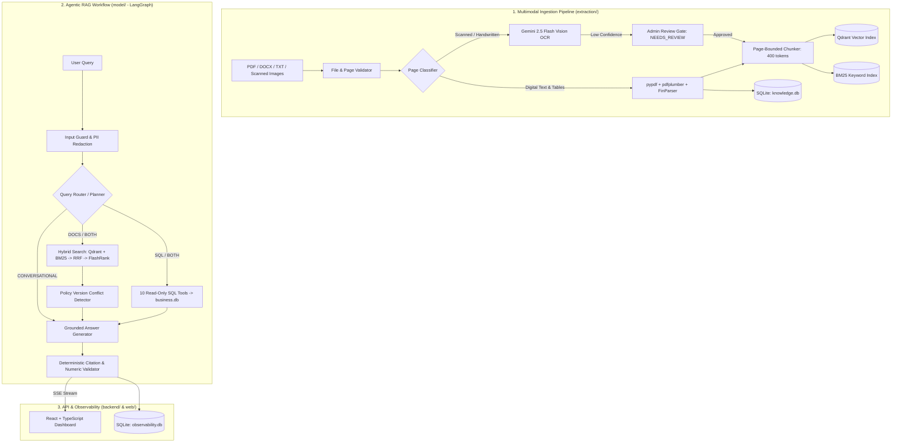

# Enterprise Knowledge Intelligence Assistant

[](https://www.python.org/)
[](https://fastapi.tiangolo.com/)
[](https://langchain-ai.github.io/langgraph/)
[](https://qdrant.tech/)
[](https://react.dev/)
[](https://www.docker.com/)

A production-grade **Agentic Hybrid RAG & Enterprise Intelligence** system that answers complex business queries across unstructured documents (PDFs, policies, scanned financial reports, handwritten notes) and structured SQL databases with **verified page-level citations**, **deterministic numeric validation**, and **full-stack observability**.

---

## Key Highlights

- **Per-Page Multimodal Ingestion:** Processes documents page-by-page using `pypdf`, `pdfplumber` (table-to-Markdown conversion), `python-docx`, and conditional **Gemini 2.5 Flash Vision OCR** for scanned pages and handwritten notes.
- **Human-in-the-Loop Quality Gates:** Automatically flags low-confidence or handwritten OCR pages into a `NEEDS_REVIEW` state for Admin verification before indexing.
- **Hybrid Retrieval + Reranking:** Combines dense semantic search (**Qdrant** with `gemini-embedding-001`) and sparse lexical search (**BM25**) via **Reciprocal Rank Fusion (RRF)**, followed by local **FlashRank** ONNX reranking.
- **Multi-Version Policy Conflict Detection:** Detects conflicting rules across policy revisions (e.g., `v1.0` vs. `v2.0`), surfaces both values transparently, and identifies the active policy.
- **10 Parameterized Read-Only SQL Tools:** Eliminates Text-to-SQL hallucination and SQL injection risks by routing quantitative queries to strictly typed Python/SQLite tools (`budget_status`, `spend_summary`, `metric_compare`, `headcount`, etc.).
- **Defense-in-Depth Guardrails:** Enforces pre-LLM PII redaction and prompt-injection checks, post-generation canary detection, deterministic number/citation verification, and strict evidence-missing fallbacks.
- **Observability & A/B Evaluation Suite:** Tracks per-stage latency, token consumption, USD cost, and grounding scores in SQLite, alongside an automated **Config A (Vector-only) vs. Config B (Hybrid + Rerank + Tools)** evaluation harness (`Hit@5`, `MRR@5`).

---

## System Architecture



*(Detailed design documentation and architecture diagrams are also available in `output/design/`.)*

---

## Repository Structure

```text
├── backend/                  # FastAPI server, SSE streaming, SQL tools, & observability
│   ├── app/api/              # REST & SSE endpoints (/query, /documents, /metrics, /tools)
│   ├── app/tools/            # 10 parameterized read-only SQLite business & finance tools
│   ├── app/observability/    # Stage-wise latency, cost, PII redaction, & outcome tracking
│   └── scripts/              # Synthetic business database generator (make_business_data.py)
├── extraction/               # Per-page ingestion, Vision OCR, financial parsing, & indexing
│   └── ingestion/            # Loaders, table extractors, chunker, Qdrant & BM25 indexers
├── model/                    # LangGraph state machine, router, hybrid retrieval, & validators
│   ├── agent/                # Graph nodes, RRF/FlashRank retrieval, numeric checks, & eval CLI
│   └── prompts/              # Versioned routing and grounded answering prompts
├── web/                      # React 18 + Vite + TypeScript + Tailwind CSS frontend
├── demo/                     # 9 sample enterprise documents (annual reports, policies, notes)
├── evals/                    # Gold extraction datasets and A/B retrieval evaluation benchmarks
├── output/design/            # System design specs, API contracts, and architecture diagram
└── docker-compose.yml        # Multi-service orchestration (FastAPI + Qdrant + React/Nginx)
```

---

## Tech Stack

| Layer | Technologies |
| :--- | :--- |
| **LLM & Vision** | Groq (`openai/gpt-oss-120b` & `20b`), Google Gemini (`gemini-2.5-flash` OCR, `gemini-embedding-001`) |
| **Orchestration & Retrieval** | LangGraph, Qdrant Vector DB, `rank_bm25`, Reciprocal Rank Fusion (RRF), FlashRank (ONNX) |
| **Backend & Storage** | Python 3.12, FastAPI, Server-Sent Events (SSE), SQLite (`knowledge.db`, `business.db`, `observability.db`) |
| **Frontend** | React 18, TypeScript, Vite, Tailwind CSS, TanStack Query, Recharts |
| **Infrastructure** | Docker, Docker Compose, Nginx |

---

## Quickstart Guide

### 1. Clone & Configure Environment

```bash
git clone https://github.com/<your-username>/<your-repo-name>.git
cd <your-repo-name>
cp .env.example .env
```

Update `.env` with your API keys:

```env
LLM_BASE_URL=https://api.groq.com/openai/v1
LLM_API_KEY=your_groq_api_key
LLM_MODEL=openai/gpt-oss-120b
LLM_FALLBACK_MODEL=openai/gpt-oss-20b

GEMINI_API_KEY=your_gemini_api_key

ADMIN_USERNAME=admin
ADMIN_PASSWORD=
```
*(Leaving `ADMIN_PASSWORD` empty enables demo authentication using `admin` / `demo`.)*

---

### 2. Start Services

#### Option A: Run with Docker Compose (Recommended)
```bash
docker compose --profile web up --build -d
```
- **Web UI:** `http://localhost:5173`
- **FastAPI Health Check:** `http://localhost:8000/health`
- **Qdrant Dashboard:** `http://localhost:6333/dashboard`

#### Option B: Run Locally (Python + Node)
1. **Start Qdrant:**
   ```bash
   docker run -d --name sprinters-qdrant -p 6333:6333 qdrant/qdrant:v1.12.5
   ```
2. **Start FastAPI Backend:**
   ```bash
   python3.12 -m venv .venv
   source .venv/bin/activate   # Windows: .venv\Scripts\activate
   pip install -r backend/requirements.txt -r model/requirements.txt -r extraction/requirements.txt

   PYTHONPATH=backend:model:extraction EXTRACTION_DATA_DIR=backend/data \
     uvicorn app.main:app --app-dir backend --reload --port 8000
   ```
3. **Start React Frontend (in a separate terminal):**
   ```bash
   cd web
   npm install
   VITE_USE_MOCKS=false API_PROXY_TARGET=http://localhost:8000 npm run dev
   ```

---

### 3. Seed Business Data & Ingest Demo Documents

1. **Generate the structured `business.db` (projects, budgets, claims, IT assets):**
   ```bash
   # Local Python:
   python backend/scripts/make_business_data.py

   # Or via Docker:
   docker compose exec -T api python - < backend/scripts/make_business_data.py
   ```
2. **Ingest the 9 demo enterprise documents (`demo/documents/manifest.yaml`):**
   ```bash
   PYTHONPATH=extraction EXTRACTION_DATA_DIR=backend/data QDRANT_URL=http://localhost:6333 \
     python -m ingestion ingest demo/documents/manifest.yaml
   ```
3. **Approve Handwritten OCR Notes:**
   Open `http://localhost:5173`, sign in to the **Admin** panel (`admin` / `demo`), and approve the flagged pages for `note-vendor-meeting-12-oct.jpg` and `note-ops-review-19-oct.jpg`.

---

## Verification & Evaluation

Run the 10-scenario end-to-end demo suite (covering policy conflicts, hybrid RAG + SQL queries, prompt-injection defense, and unanswerable fallbacks):

```bash
PYTHONPATH=model python -m agent.demo --api http://localhost:8000
```

Run the automated A/B retrieval & grounding benchmark (`evals/eval_set.jsonl`):

```bash
PYTHONPATH=backend:model:extraction python -m agent.eval_cli
```

---

## Approved Read-Only SQL Tools

Instead of generating raw SQL from an LLM, the planner invokes validated tools with strict schema checks:

| Category | Tools |
| :--- | :--- |
| **Projects & Expenses** | `project_info`, `budget_status`, `spend_summary`, `claims_list` |
| **IT & Workforce** | `asset_compliance`, `headcount` |
| **Financial Analytics** | `metric_value`, `metric_compare`, `metric_trend`, `segment_breakdown` |